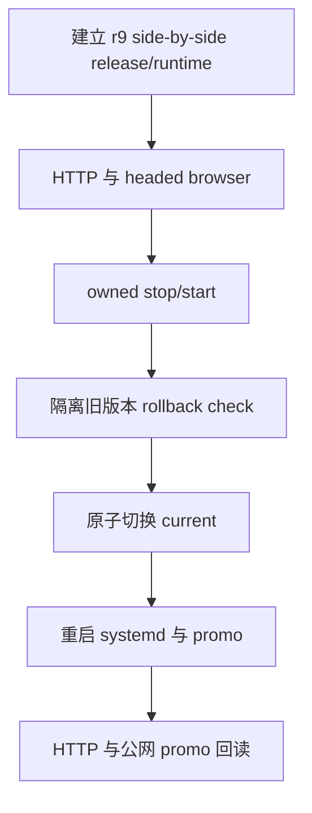

# RC1 杭州 WSL owner-operated r9 当前切换回执

日期：2026-10-18

## 结论

r9 已在杭州 WSL 完成 side-by-side 安装。

验证完成后，`/srv/shinemage/dsh/current` 已原子切换到：

```text
/srv/shinemage/dsh/releases/dsh-0.2.1-rc.1-owner-r9-20261018
```

systemd、page HTTP 和 promo helper 已重启并保持 `active`。

公开 promo URL 的 cookie 跟随后返回 `200`。
未认证根路径仍返回 `401`。

这次是内部 owner-operated 切换。
这次不是正式公司 release。

正式状态保持：

```text
M2-07=BLOCKED
M2-08=NOT_RUN
M2-09=NOT_RUN
release_ready=false
```

## 执行顺序



每一步都读取了真实目标输出。
候选端口在切换前已释放。
旧 release 和 rollback target 均保留。

## 候选输入

| 项目 | 实际值 |
|---|---|
| SDK | `@deepseek-ai/dsh@0.2.1-rc.1` |
| upstream SHA | `1600d8a1e140dcde43a1a0941940a0480712c011` |
| source tree SHA-256 | `1da0862e853d126219dbec4b77bd7187776112f620adadc12ccda07c420c3f4a` |
| generated tree SHA-256 | `2d91073d45c2534cb27d6129545c6cc86e0ed50c9bc038a402a79152bec8335b` |
| preparation receipt SHA-256 | `2d2f00923d8bc64b5efc5369b7eb9b3177d97c59354a24fdf8e83458adc5d971` |
| runtime archive SHA-256 | `ed11ec808d939bbab292738be6227e8882c95889d3af5db1a9febbc318aa05a2` |
| runtime provenance SHA-256 | `22c710ca15e59d4659338a27b798f298d227b03b02c1c6ba912889df16e6921e` |
| pack inputs SHA-256 | `7dc6298240bca26b6a97878e2b23ab010be26f1f83cb9576d8a491933ba504fc` |
| profile SHA-256 | `e93e6f5e7975311f55bf1ee070b7aea009c938449c9a1542f3c2a503f40253fc` |
| target Node | `v24.21.0` |
| upstream pnpm | `11.28.5` |
| plugin pnpm | `11.28.2` |
| provenance schema | `dsh-generated-bytes/v1` |
| portable scan | `29207` files, `0` host-path findings, `0` native findings |

## Side-by-side、HTTP 和 stop/start

候选使用：

```text
web: 127.0.0.1:14327
page HTTP: 127.0.0.1:18155
runtime: /srv/shinemage/dsh/runtime-rc1-owner-r9-20261018
```

首次候选启动：

- supervisor PID：`1446346`
- 未认证 web 根路径：`401`
- page HTTP 根路径：`404`
- profile bridge：`linked=13 plugin_roots=7`
- pnpm：`11.28.2`
- 日志包含 `DSH_DEV_READY`

执行候选 stop 后，`14327` 和 `18155` 释放。
杭州现役 `4328`、`18091` 和 `18098` 未停止。

随后用目标固定 `tools/bin` 和 `DSH_DEV_TOOLCHAIN` 重启候选：

- supervisor PID：`1453657`
- profile bridge：`linked=13 plugin_roots=7`
- pnpm：`11.28.2`
- 候选端口在切换前再次释放

中间一次不带固定工具链的重启曾真实失败：

```text
DSH_DEV_PNPM_VERSION
actual: 11.19.0
expected: 11.28.2
```

该失败已通过目标固定工具链重跑解决。

## headed browser 回读

使用 Chrome headed browser 通过 owner SSH tunnel 回读。

候选 stop 前：

- 标题：`伸美 AI 增长董事会`
- 插件页：可打开
- 已启用插件：`7`
- 驾驶舱：可打开
- 驾驶舱标题：`项目驾驶舱`

候选重启后：

- 插件管理页仍显示 `7` 个已安装且启用的 Shine Mage 插件
- 驾驶舱标题仍为 `项目驾驶舱`
- 驾驶舱显示 `待处理 0`、`暂无产物`
- 实时事件显示不可用，并启用刷新扫描
- 未执行模型调用
- 本次回执没有单独采集 console error 数量，因此记为 `NOT_CAPTURED`

重启后实际显示的浏览器标题为 `DeepSeek Harness`。
这不影响插件清单和驾驶舱页面回读，但保留为真实观察结果。

## rollback check

回滚检查使用独立副本，没有改动现役 `current`：

```text
release: /srv/shinemage/dsh/releases/dsh-0.2.1-rc.1-owner-rollback-check-20261018
runtime: /srv/shinemage/dsh/runtime-rc1-owner-rollback-check-20261018
web: 127.0.0.1:14327
page HTTP: 127.0.0.1:18155
```

真实结果：

- rollback supervisor PID：`1456258`
- web 未认证根路径：`401`
- page HTTP 根路径：`404`
- fallback runtime version：`0.2.1-rc.1`
- rollback 检查期间现役 systemd 保持 `active`
- rollback 候选 stop 已确认，`14327` 和 `18155` 释放

现役回退目标仍保留：

```text
/srv/shinemage/dsh/releases/dsh-0.20.0.0-r3
```

## current 切换后的真实输出

| 检查 | 结果 |
|---|---|
| `current` | `/srv/shinemage/dsh/releases/dsh-0.2.1-rc.1-owner-r9-20261018` |
| `shinemage-dsh.service` | `active` |
| `shinemage-dsh-promo-enter.service` | `active` |
| web `127.0.0.1:4328/` | `401` |
| page HTTP `127.0.0.1:18091/` | `404` |
| promo helper `127.0.0.1:18098/` | `302` |
| 公网 promo 跟随 | `200` |
| 公网未认证根路径 | `401` |
| profile bridge | `linked=13 plugin_roots=7` |
| observed pnpm | `11.28.2` |
| ready marker | `DSH_DEV_READY` |

systemd drop-in 和 promo helper 的原文件已备份到：

```text
/srv/shinemage/dsh/backups/cutover-r9-20261018/
```

promo helper 现在读取：

```text
/srv/shinemage/dsh/runtime-rc1-owner-r9-20261018/browser-private.json
```

## 正式门禁边界

以下事项仍未完成：

- publisher identity
- company signature
- independent verification
- revocation
- final attestation
- formal clean-machine receipt

owner-local runtime provenance、owner self-signature 和 owner fresh extraction 不能替代正式公司门禁。

因此本次不能把 owner-operated 切换写成正式 release，也没有创建 GitHub Release、push 或执行正式发布。
