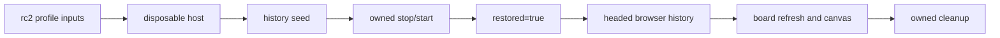

# rc2 web rollback headed recovery（2026-10-18）

本回执只记录固定 rc2 pin 下的 owner-only disposable synthetic 验证。它不关闭正式 M2 门禁，也不代表杭州或公网部署。

## 结果

1. 使用固定 `0.1.7-rc.2`、upstream `477b4f420553e8a52c2fbccc464d7561b239c443` 和刚生成的 page/CRM profile inputs 启动 disposable host。
2. 重启前 seed 返回 HTTP `200`、`restored=false`、`modelCalls=0`、`containsRealData=false`。
3. 对同一 runtime 和同一 session 执行 owned stop/start。重启后的首次 seed 返回 HTTP `200`、`restored=true`，history 文件 SHA 与重启前相同。
4. 真实 Chrome headed browser 回读 history 会话、`rc2-web-history.html` 和 board tool card。驾驶舱刷新后显示 `rc2 web rollback synthetic board`，点击后显示 `看板画布，可横向和纵向滚动`、`合成说明` 和固定 source SHA。控制台错误为 `0`。
5. board service 的四个只读 endpoint 均返回 HTTP `200`。请求日志记录了带授权头的浏览器读取，但没有保存 token。
6. 停止本次 host 和 board service。`4325`、`18169`、`18170` 已关闭；`4329`、`14327` 保持原状。

## 边界

这是内部 owner-operated 的合成回滚证据。它证明 disposable host 的 history/board 回读、重启恢复和清理路径可回放。它不证明真实业务数据、公司发布身份、签名、独立核验、撤销、正式 clean machine、杭州切换或 release readiness。

机器可读回执见 [rc2-web-rollback-headed-recovery-20261018.json](rc2-web-rollback-headed-recovery-20261018.json)。外部原始输出位于 `/Users/hutou/.codex/tasks/rc2-web-rollback-20261018/restart-r2/`。

`restored=true` 来自重启后的真实 seed 回执。浏览器证据来自 Chrome headed tab `199377534`。正式状态仍为 `M2-07=BLOCKED`、`M2-08=NOT_RUN`、`M2-09=NOT_RUN`、`release_ready=false`。
