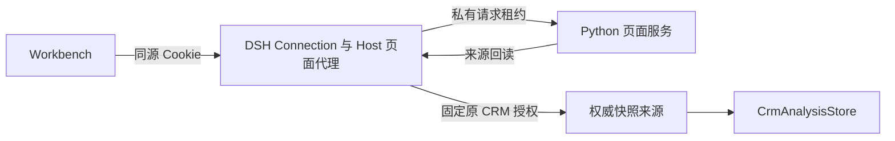

# 原生页面与 CRM 来源

当前实现连接 CRM 快照、页面保存和 Workbench 预览。它默认关闭，按单个 DSH owner 运行。经营聚合使用 `crm-page-aggregate/v1`，已登记的商品与 RFM warehouse 快照使用各自仓库投影。缓存覆盖和真实业务验收单列记账。

## 请求与身份

`POST /api/shine-mage-pages` 使用上游 Connection 的 owner、Host、Origin 和 Cookie 准入。页面 owner 与 CRM 账号分开。浏览器只提交操作与资源选择条件，不能指定来源服务地址、owner、scopes、连接代次、Host epoch 或权威数字。

Host 为单次请求生成私有租约，绑定方法、路径、查询、请求体摘要、幂等键和期限。Python 回调核验后取得 `PageRequestContext`。首次使用来源时，Host 打开已有 `openNativeSnapshotLease`，固定原登录记录，后续读取不能借用新登录。

动态读取从服务端 page 或 preview target 取得 manifest 和 session。实际 iframe 通过 `mountLibraryPreview` 的受控 adapter 读取，target 由宿主确定。切换页面、版本或预览会使旧通道失效。iframe 不能执行 SQL、修改权限或指定其他页面。

## 数值与保存

`crm-page-aggregate/v1` 固定输出五行，顶层单位为 `per-row`。GSV 保留人民币分整数；AOV、AUS 保留原值、空值、分母和原因，不二次相除。订单与买家使用计数单位。查询筛选、coverage、limitations、快照时间、原期限和投影版本随结果保留。

预览、首次确认、binding-state 与动态读取使用同一来源。缓存和 data_ref 绑定 actor、session、连接代次、Host epoch、ref、来源摘要、投影版本及 target；缓存命中也重新核权。网络读取不持页面写事务或结果缓存锁。

首次确认失败不产生新 head、revision 或成功回执。历史页面、历史文字叠层与已成功确认的重放不要求 CRM 在线。跨进程核验不提供原子撤权，也不能收回已经交付的数字。

## 一次请求内的批量观察

当 CRM service 明确声明 `nativeSnapshotBatchMax=16`，页面 Host 才在私有认证回调中声明 `source_batch_max=16`。Python 页面服务据此启用批量读取。旧 Host 或旧 CRM 插件没有声明时，继续使用原单条协议；不猜测支持情况。

`PageDocumentStore._bind` 在本次 HTTP 请求预取全部引用，每批最多 16 项。`NativePageSource.read` 可以复用本请求已观察到的原始快照，仍逐项验证投影和绑定。观察不会延长来源授权，也不会转移到下一次请求。

写入前的 `PageRequestContext.revalidate` 会绕过预取，重新读取全部已观察来源，并与原始基准逐项比较。缺项、错配、撤权、账号或连接代次变化、Host epoch 变化、超时和来源错误均不能生成新版本或成功回执。分批操作共用页面请求原期限，不逐批续期。iframe 的单条 `data.read` 合同不变。

原生文字与结构编辑复用已有 edit-context、区域哈希、CAS 和幂等确认。声明为绑定数值的节点保持只读。页面文案与结构变化不写入业务数据库，来源认证也不表示宿主背书整份 HTML 的经营结论。

## AI 修改候选

原生页面任务使用固定的 `session-cockpit-native-ai-<UUID>` 会话和 `shine-native-page-editor-v1` 预设。模型只取得 `cockpit_page_read` 与 `cockpit_page_propose`，不能使用文件、终端、网络、子任务或安装插件工具。独立策略插件按会话 ID 约束工具权限，不依赖可切换的当前预设。页面 Host 卸载后撤走两个编辑工具，策略继续限制存活及恢复的 agent；Host 缺少策略服务时不会启用。重新打开任务复用原会话，新建返回了不同 ID 时停止发送。

读取按 Unicode 字符分页，每次最多 2000 字符，并返回下一偏移、来源及候选摘要。每次提交从任务的原始源码应用全部精确替换；来源摘要和前一候选摘要不匹配时拒绝。HTML/CSS/JS 及 presentation JSON 均经页面合同检查。渲染后选区只允许改该选区的 presentation；绑定页仅允许 CSS 或受控 presentation 样式，不能改写数值或文案。已有 presentation 的整页 HTML/JS 修改须回源码入口核对，当前不会自动迁移定位。

模型只能提交候选。用户仍须收取、预览、确认才生成新版本，首次保存重新核对来源。原生页面与旧文件任务按各自 transport 路由；恢复未知任务仅在原生 GET 明确返回 404 时尝试旧文件服务，不在写入或来源故障时自动改道。任务列表按服务独立恢复，一方失败时仍显示另一方任务，并保留失败来源已知任务及错误提示。

生成工具及原生 AI 候选入口会拒绝孤立或未闭合的 textarea 标签，不猜测补写模型源码。这是具体标记检查，并非完整 HTML 语义校验。现有历史页面不会因此被改写。

## 显式配置

Host 配置示例为 [`native-page.config.example.json`](../../scripts/dsh-dev/native-page.config.example.json)。复制后先将 `file:///absolute/path/to/repository/` 替换为实际仓库绝对路径，再配置独立页面端口与私有回调端口。策略插件与页面 Host 是两个独立条目，`enabled` 均默认 `false`，使用时须同时启用。策略插件须在页面 Host 的卸载、重载期间保留；撤除整套策略属于管理员配置变更。原生 CRM Host 仍需单独配置已有的 `nativeSnapshot` 来源。

页面进程入口为 [`native_page_server.py`](../../scripts/dsh-dev/native_page_server.py)，要求预先创建的私有 `--state-dir`、`--port` 和 `--callback-origin`。它只监听 `127.0.0.1`，拒绝 6677。加载配置与启动实例属于显式运维操作，普通检查不启动服务。

Host 向浏览器只注入布尔值 `__NATIVE_PAGE_TRANSPORT__`。原生模式不注入服务间凭据。旧隔离 HTTP 模式及其端口拒绝规则保留，未配置时不回退到现场服务或 fixture session。

来源服务最多同时处理四个操作；突发超限可能返回结构化 503。页面转发、私有回调和来源 introspection 使用独立容量。编辑接口的同步核权在工作线程执行，等待来源不阻塞页面服务事件循环。

## 验证边界

本地跨进程入口为 `scripts/dsh-dev/test_native_page_composition.py`，须显式设置 `CRM_NATIVE_HOST_PLUGIN`、`WORKBENCH_NATIVE_PAGE_PLUGIN`、`DSH_NATIVE_UPSTREAM`、`CRM_SERVICE_PYTHON` 和 `FQ_B0_PYTHON`。它使用自建小型 DuckDB、合成账号和自有端口，不读取现役状态。测试后的临时进程由测试回收。

实际 MessageChannel 测试经过维护中的预览入口，未执行浏览器 iframe 内脚本。源码测试、固定 SDK 构建、作者 CI、严格包接收、真实浏览器业务和部署分别记账。当前结果与未关闭项见[接线证据](../hackathon/evidence/dsh-native-page-runtime-20261025.md)。
